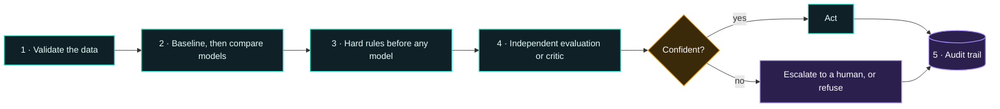
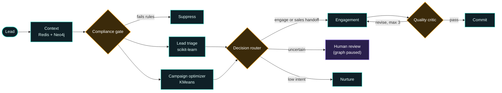
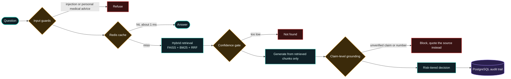

<!-- ============ HEADER ============ -->
<p align="center">
  
</p>

<p align="center">
  <a href="https://git.io/typing-svg">
    
  </a>
</p>

<p align="center">
  
  
  
  
  
  
</p>

<p align="center">
  
  
  
</p>

---

## 🧬 `whoami`

```python
class AdityaPurohit:
    role      = "AI/ML Engineer & Full Stack Developer @ Microtech Solutions"
    based_in  = "Kolhapur, India 🇮🇳"
    education = "PG Diploma in Artificial Intelligence, IIT Jodhpur"
    focus     = [
        "Machine learning & decisioning systems",
        "NLP & LLM applications",
        "Agentic AI & orchestration",
        "Evaluation, guardrails & reliability",
    ]

    def build(self, problem):
        data  = self.validate(problem.data)        # trust, but verify the labels
        model = self.baseline_then_improve(data)   # simple and explainable first
        return self.add_guardrails(model)          # hard rules, critics, human review
```

> Whether it's a classifier or an LLM, I treat every model as something to **validate before it's trusted**, and I build systems that can explain every decision they make.

---

## ⚡ Impact at a Glance

<p align="center">
  
  
</p>
<p align="center">
  
  
</p>
<p align="center">
  
  
</p>

<sub>RAG figures come from my own 19-question golden evaluation set, which I treat as a regression suite rather than proof of real-world accuracy. The lead model was trained on simulated outcome labels, because the dataset's original labels carried no signal (ROC-AUC 0.50). I disclose that in the model card.</sub>

---

## 🎯 What I Work On

| | |
|:--|:--|
| 📊 **Machine Learning** | Predictive scoring and clustering with scikit-learn: model comparison, calibration, and explainable reason codes |
| 🗣️ **NLP & LLM Apps** | Embeddings, hybrid retrieval, grounding and hallucination detection |
| 🤖 **Agentic Systems** | Multi-agent workflows in LangGraph with parallel branches, critic loops and human-in-the-loop review |
| 🧪 **Evaluation & Safety** | Golden test sets, quality gates, compliance rules and audit trails |
| ⚙️ **Full Stack Engineering** | REST APIs, WebSockets, PostgreSQL, MongoDB, Redis and Neo4j |

---

## 🏗️ How I Build AI Systems



---

## 🚀 Project Spotlights

### 🤖 Multi-Agent Lead Decisioning &nbsp;·&nbsp; [View repo](https://github.com/adityapurohit-tech/multi-agent-lead-decisioning)

| | |
|:--|:--|
| **Problem** | Marketing teams make repetitive triage and campaign decisions that have to be consistent, explainable and safe to automate. |
| **Approach** | An 11-agent LangGraph workflow. A compliance gate runs before any model. Lead triage (logistic regression with reason codes) and campaign clustering (KMeans) run in parallel. A critic loop is capped at 3 revisions, and borderline leads pause the graph for human review. Redis holds fast state and frequency caps, and Neo4j holds the lead, campaign and decision graph. |
| **Result** | 0.863 ROC-AUC against a 0.632 baseline, and 5,000 leads processed with zero failures. |

     

<details>
<summary><b>🔎 See the agent graph</b></summary>



</details>

### 🧠 Regulatory-Grade RAG Platform &nbsp;·&nbsp; [View repo](https://github.com/adityapurohit-tech/Regulatory-Grade-Risk-Aware-Enterprise-RAG-Platform)

| | |
|:--|:--|
| **Problem** | Most RAG demos look impressive but quietly hallucinate. In a regulated or healthcare setting, a wrong answer isn't acceptable. |
| **Approach** | Hybrid retrieval (FAISS + BM25 fused with Reciprocal Rank Fusion), a confidence gate that skips the model when nothing relevant is found, and claim-level grounding that blocks any unverified claim or number. Redis handles caching and rate limiting, and every decision is written to a PostgreSQL audit trail. |
| **Result** | Answerable questions went from 2 of 13 to 13 of 13 correct on my golden set, with 100% safety held throughout. Refusals dropped from about 2.4 s to under 4 ms. |

     

<details>
<summary><b>🔎 See the pipeline</b></summary>



</details>

### 📦 More Projects

<p align="center">
  <a href="https://github.com/adityapurohit-tech/saasquatch-lead-scorer">
    
  </a>
  <a href="https://github.com/adityapurohit-tech/AI-Expert-Call-Analyzer">
    
  </a>
  <a href="https://github.com/adityapurohit-tech/AI-Decision-Simulation-System">
    
  </a>
</p>

---

## 🧭 Engineering Principles

- 🧪 **Validate the data before the model.** If the labels are noise, say so out loud.
- 🛡️ **Hard rules first, ML second.** Compliance checks run before any model is called.
- 🔍 **Never let the writer grade its own work.** An independent critic checks every draft.
- 🙋 **Escalate when unsure.** Borderline cases pause for a human instead of guessing.
- 📜 **Every decision leaves a trail** that can be replayed and audited.

---

## 🗺️ What's Next on My List

- 🔬 An **NLI entailment model** as a second grader, to catch negation flips like "is covered" turning into "is not covered"
- 📄 **OCR** for scanned PDFs, and a **semantic cache** to raise the cache hit rate
- ✍️ An **LLM drafting step** in the agent system, with the independent critic left exactly as it is
- 🔌 Going deeper on agent protocols (**MCP** and **A2A**)

---

## 🛠️ Toolbox

<p align="center">
  
</p>

<p align="center"><sub><b>Also:</b> LangChain · LangGraph · FAISS · BM25 · NLP · WebSockets · REST APIs</sub></p>

<p align="center">
  
</p>

---

## 🤝 Let's Connect

I'm open to AI / ML engineering roles where reliability matters as much as capability.

<p align="center">
  <a href="https://www.linkedin.com/in/aditya-purohit-77a287227/"></a>
  <a href="mailto:adityapurohit2002@gmail.com"></a>
</p>

<p align="center">
  
</p>

<p align="center">
  
</p>
