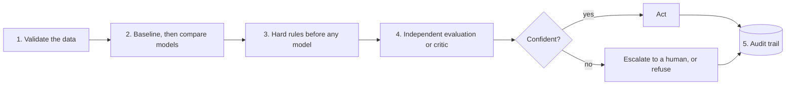
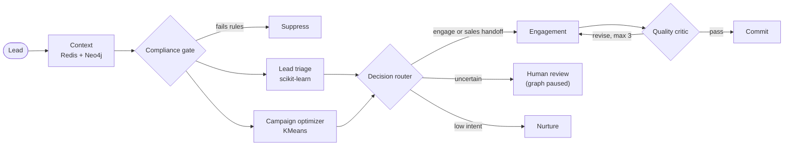
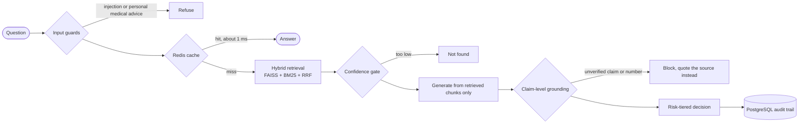

<!-- ============ HEADER ============ -->
<p align="center">
  
</p>

<p align="center">
  <a href="https://git.io/typing-svg">
    
  </a>
</p>

<p align="center">
  
  
  
  
  
  
</p>

---

## 🧬 `whoami`

```python
class AdityaPurohit:
    role      = "AI/ML Engineer & Full Stack Developer @ Microtech Solutions"
    based_in  = "Kolhapur, India 🇮🇳"
    education = "PG Diploma in Artificial Intelligence, IIT Jodhpur"
    focus     = [
        "Machine learning & decisioning systems",
        "NLP & LLM applications",
        "Agentic AI & orchestration",
        "Evaluation, guardrails & reliability",
    ]

    def build(self, problem):
        data  = self.validate(problem.data)        # trust, but verify the labels
        model = self.baseline_then_improve(data)   # simple and explainable first
        return self.add_guardrails(model)          # hard rules, critics, human review
```

> Whether it's a classifier or an LLM, I treat every model as something to **validate before it's trusted**, and I build systems that can explain every decision they make.

---

## 🎯 What I Work On

| | |
|:--|:--|
| 📊 **Machine Learning** | Predictive scoring and clustering with scikit-learn: model comparison, calibration, and explainable reason codes |
| 🗣️ **NLP & LLM Apps** | Embeddings, hybrid retrieval, grounding and hallucination detection |
| 🤖 **Agentic Systems** | Multi-agent workflows in LangGraph with parallel branches, critic loops and human-in-the-loop review |
| 🧪 **Evaluation & Safety** | Golden test sets, quality gates, compliance rules and audit trails |
| ⚙️ **Full Stack Engineering** | REST APIs, WebSockets, PostgreSQL, MongoDB, Redis and Neo4j |

---

## 📈 By the Numbers

| 🤖 Multi-Agent Decisioning | 🧠 RAG Platform |
|:--|:--|
| **0.863 ROC-AUC** on held-out data, against a **0.632** baseline | **2 / 13 → 13 / 13** answerable questions correct, with **100%** safety held throughout |
| **5,000 leads** processed end to end with **zero failures** | Refused-question latency **~2.4 s → under 4 ms** |
| **11 agents** with parallel branches, a critic loop and human review | Repeat questions served from Redis in **~1 ms** |

<sub>RAG figures come from my own 19-question golden evaluation set, which I treat as a regression suite rather than proof of real-world accuracy. The lead model was trained on simulated outcome labels, because the dataset's original labels carried no signal (ROC-AUC 0.50). I disclose that in the model card.</sub>

---

## 🏗️ How I Build AI Systems



<details>
<summary><b>🔎 See it in practice: the multi-agent lead decisioning graph</b></summary>



</details>

<details>
<summary><b>🔎 See it in practice: the RAG platform pipeline</b></summary>



</details>

---

## 🧭 Engineering Principles

- 🧪 **Validate the data before the model.** If the labels are noise, say so out loud.
- 🛡️ **Hard rules first, ML second.** Compliance checks run before any model is called.
- 🔍 **Never let the writer grade its own work.** An independent critic checks every draft.
- 🙋 **Escalate when unsure.** Borderline cases pause for a human instead of guessing.
- 📜 **Every decision leaves a trail** that can be replayed and audited.

---

## 🚀 Featured Work

<p align="center">
  <a href="https://github.com/adityapurohit-tech/multi-agent-lead-decisioning">
    
  </a>
  <a href="https://github.com/adityapurohit-tech/Regulatory-Grade-Risk-Aware-Enterprise-RAG-Platform">
    
  </a>
</p>
<p align="center">
  <a href="https://github.com/adityapurohit-tech/saasquatch-lead-scorer">
    
  </a>
  <a href="https://github.com/adityapurohit-tech/AI-Expert-Call-Analyzer">
    
  </a>
  <a href="https://github.com/adityapurohit-tech/AI-Decision-Simulation-System">
    
  </a>
</p>

---

## 🛠️ Toolbox

<p align="center">
  
</p>

<p align="center"><sub><b>Also:</b> LangChain · LangGraph · FAISS · BM25 · NLP · WebSockets · REST APIs</sub></p>

---

## 📊 Activity

<p align="center">
  
</p>

<p align="center">
  
</p>

---

## 🤝 Let's Connect

I'm open to AI / ML engineering roles where reliability matters as much as capability.

<p align="center">
  <a href="https://www.linkedin.com/in/aditya-purohit-77a287227/"></a>
  <a href="mailto:adityapurohit2002@gmail.com"></a>
</p>

<p align="center">
  
</p>

<p align="center">
  
</p>
