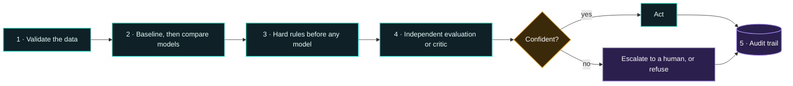
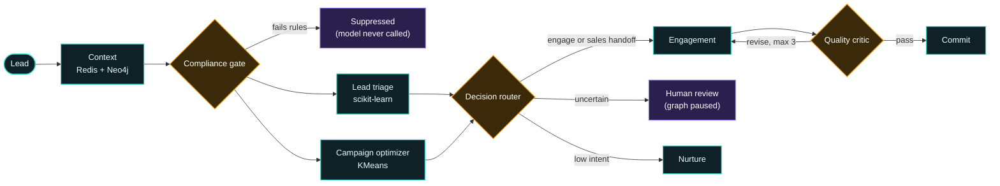
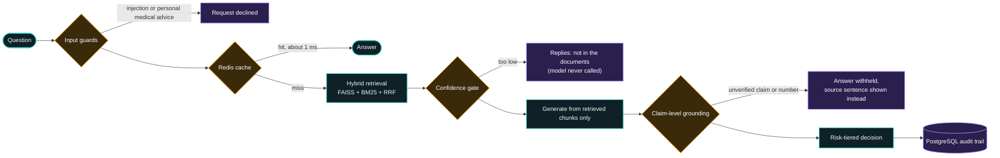

<!-- ============ HEADER ============ -->
<p align="center">
  
</p>

<p align="center">
  <a href="https://git.io/typing-svg">
    
  </a>
</p>

<p align="center">
  
  
  
</p>

<p align="center">
  <a href="https://www.linkedin.com/in/aditya-purohit-77a287227/"></a>
  <a href="mailto:adityapurohit2002@gmail.com"></a>
</p>

---

## 💡 What I Bring

| 🧠 Trustworthy LLM Apps | 📊 Explainable ML | 🤖 Agentic AI Systems |
|:--|:--|:--|
| **AI that proves its answers.** Every claim is traced back to a source, and when it can't be verified, the system says so instead of guessing. | **Predictions you can defend.** Calibrated scores with plain-English reasons, so every decision can be explained to a stakeholder. | **Automation with judgment.** Parallel agents, an independent critic and a human in the loop for the calls that matter. |

---

## 🧬 `whoami`

```python
class AdityaPurohit:
    role      = "AI/ML Engineer"
    based_in  = "Kolhapur, India 🇮🇳"
    education = "PG Diploma in Artificial Intelligence, IIT Jodhpur"
    focus     = [
        "Machine learning & decisioning systems",
        "NLP & LLM applications",
        "Agentic AI & orchestration",
        "Evaluation, guardrails & reliability",
    ]

    def build(self, problem):
        data  = self.validate(problem.data)        # trust, but verify the labels
        model = self.baseline_then_improve(data)   # simple and explainable first
        return self.add_guardrails(model)          # hard rules, critics, human review
```

> Whether it's a classifier or an LLM, I treat every model as something to **validate before it's trusted**, and I build systems that can explain every decision they make.

---

## ⚡ Impact at a Glance

<table align="center">
  <tr>
    <td align="center" width="33%"><br/><br/><br/><b>ROC-AUC</b><br/>lead model, against a 0.632 baseline<br/><br/></td>
    <td align="center" width="33%"><br/><br/><br/><b>Leads processed</b><br/>end to end, with zero failures<br/><br/></td>
    <td align="center" width="33%"><br/><br/><br/><b>Agents working together</b><br/>parallel branches, critic loop, human review<br/><br/></td>
  </tr>
  <tr>
    <td align="center" width="33%"><br/><br/><br/><b>Answerable questions correct</b><br/>up from 2 / 13, with safety held at 100%<br/><br/></td>
    <td align="center" width="33%"><br/><br/><br/><b>Cached answers</b><br/>Redis, cleared automatically when documents change<br/><br/></td>
    <td align="center" width="33%"><br/><br/><br/><b>Refusal latency</b><br/>down from 2.4 s, because the model is never called<br/><br/></td>
  </tr>
</table>

<p align="center"><sub>RAG figures come from my own 19-question golden evaluation set, which I treat as a regression suite rather than proof of real-world accuracy. The lead model was trained on simulated outcome labels, because the dataset's original labels carried no signal (ROC-AUC 0.50). I disclose that in the model card.</sub></p>

---

## 🎬 See It in Action

<sub>🟩 green = the outcome &nbsp;·&nbsp; 🟥 red = something the system rejected</sub>

**🧠 RAG platform: when the answer isn't in the documents**

```diff
  ❯ Q: How many languages are interpreter services available in?
    ├─ input guards ... passed
    ├─ cache .......... miss
    ├─ retrieval ...... best match is below the 0.40 confidence threshold
    ├─ generation ..... NOT CALLED (the model never gets the chance to guess)
+   └─ reply .......... "Not found in sources"                    ⏱ under 4 ms
```

**🧠 RAG platform: when the model is wrong and the system catches it**

```diff
  ❯ Q: Does the discharge protocol apply to patients who leave against medical advice?
-   ├─ model's own answer ... "no"      ✗ can't be verified against the source
    ├─ grounding check ...... rejected
+   └─ reply ................ the exact source sentence instead:
+                             "This protocol does not apply to patients who leave against
+                              medical advice; those patients follow Protocol CL-DS-07."
```

**🤖 Multi-agent system: a hot lead, and a borderline one**

```diff
  ❯ Hot lead  →  triage 0.83 (Hot) · 4 callback requests vs an average of 1.6 · 0 unsubscribes
-   ├─ Engagement draft 1 ... CTA "Get Audit"      ✗ critic: hot leads need a meeting CTA
+   ├─ Engagement draft 2 ... meeting CTA          ✓ critic passed
+   └─ route ................ sales handoff

  ❯ Borderline lead  →  triage 0.594 (just under the 0.6 Hot threshold)
    └─ route ................ ⏸ graph paused for a human decision (LangGraph interrupt)
```

<sub>Demo runs use synthetic healthcare documents and synthetic lead data. No real patient or customer data.</sub>

---

## 🏗️ How I Build AI Systems



---

## 🚀 Project Spotlights

### 🤖 Multi-Agent Lead Decisioning &nbsp;·&nbsp; [View repo](https://github.com/adityapurohit-tech/multi-agent-lead-decisioning)

| | |
|:--|:--|
| **Problem** | Marketing teams make repetitive triage and campaign decisions that have to be consistent, explainable and safe to automate. |
| **Approach** | An 11-agent LangGraph workflow. A compliance gate runs before any model. Lead triage (logistic regression with reason codes) and campaign clustering (KMeans) run in parallel. A critic loop is capped at 3 revisions, and borderline leads pause the graph for human review. Redis holds fast state and frequency caps, and Neo4j holds the lead, campaign and decision graph. |
| **Result** | 0.863 ROC-AUC against a 0.632 baseline, and 5,000 leads processed with zero failures. |

     

<details>
<summary><b>🔎 See the agent graph</b></summary>



<sub>🟦 Teal = steps · 🟧 Amber = checkpoints · 🟪 Purple = safe stops, where the system holds back on purpose</sub>

</details>

### 🧠 Regulatory-Grade RAG Platform &nbsp;·&nbsp; [View repo](https://github.com/adityapurohit-tech/Regulatory-Grade-Risk-Aware-Enterprise-RAG-Platform)

| | |
|:--|:--|
| **Problem** | Most RAG demos look impressive but quietly hallucinate. In a regulated or healthcare setting, a wrong answer isn't acceptable. |
| **Approach** | Hybrid retrieval (FAISS + BM25 fused with Reciprocal Rank Fusion), a confidence gate that skips the model when nothing relevant is found, and claim-level grounding that blocks any unverified claim or number. Redis handles caching and rate limiting, and every decision is written to a PostgreSQL audit trail. |
| **Result** | Answerable questions went from 2 of 13 to 13 of 13 correct on my golden set, with 100% safety held throughout. Refusals dropped from about 2.4 s to under 4 ms. |

     

<details>
<summary><b>🔎 See the pipeline</b></summary>



<sub>🟦 Teal = steps · 🟧 Amber = checkpoints · 🟪 Purple = safe stops. These are the system refusing on purpose, not errors.</sub>

</details>

### 📦 More Projects

<p align="center">
  <a href="https://github.com/adityapurohit-tech/saasquatch-lead-scorer">
    
  </a>
  <a href="https://github.com/adityapurohit-tech/AI-Expert-Call-Analyzer">
    
  </a>
  <a href="https://github.com/adityapurohit-tech/AI-Decision-Simulation-System">
    
  </a>
</p>

---

## 🤝 Work With Me

I'm open to AI / ML engineering roles and select project collaborations.

| What I can build | What you get |
|:--|:--|
| 📄 **Document Q&A (RAG) with guardrails** | Answers that cite the exact source, or a clear "not found" instead of a guess |
| 📊 **Predictive scoring & decisioning** | Calibrated scores with plain-English reasons for every decision |
| 🤖 **Multi-agent workflows** | Automation that pauses for human approval on borderline cases |
| 🧪 **Evaluation & quality gates for LLM apps** | Measurable accuracy and safety numbers before anything ships |
| ⚙️ **Full-stack AI apps** | Flask / REST / WebSocket backends with audit trails and live dashboards |

**How I work**

| 1 · Understand | 2 · Validate | 3 · Build | 4 · Measure |
|:--|:--|:--|:--|
| The decision and its risks | The data, before any model | The smallest working version, with tests | Show you the numbers |

<p align="center">
  <a href="mailto:adityapurohit2002@gmail.com?subject=Let%27s%20talk%20about%20a%20project"></a>
</p>

---

## 🧭 Engineering Principles

- 🧪 **Validate the data before the model.** If the labels are noise, say so out loud.
- 🛡️ **Hard rules first, ML second.** Compliance checks run before any model is called.
- 🔍 **Never let the writer grade its own work.** An independent critic checks every draft.
- 🙋 **Escalate when unsure.** Borderline cases pause for a human instead of guessing.
- 📜 **Every decision leaves a trail** that can be replayed and audited.

---

## 🗺️ What's Next on My List

- 🔬 An **NLI entailment model** as a second grader, to catch negation flips like "is covered" turning into "is not covered"
- 📄 **OCR** for scanned PDFs, and a **semantic cache** to raise the cache hit rate
- ✍️ An **LLM drafting step** in the agent system, with the independent critic left exactly as it is
- 🔌 Going deeper on agent protocols (**MCP** and **A2A**)

---

## 🛠️ Toolbox

**Languages & ML**

    

**LLM & Agents**

    

**Backend & Data**

      

**Cloud & Tools**

 

---

## 🎓 Education & Learning

- **Post-Graduate Diploma in Artificial Intelligence**, IIT Jodhpur (2025 – 2026)
- **AI & ML Bootcamp**, Udemy
- **AI Engineer** and **AI / Data Scientist** tracks, OneRoadmap

---

## 📫 Let's Connect

<p align="center">
  <a href="https://www.linkedin.com/in/aditya-purohit-77a287227/"></a>
  <a href="mailto:adityapurohit2002@gmail.com"></a>
</p>

<p align="center">
  
</p>

<p align="center">
  
</p>
